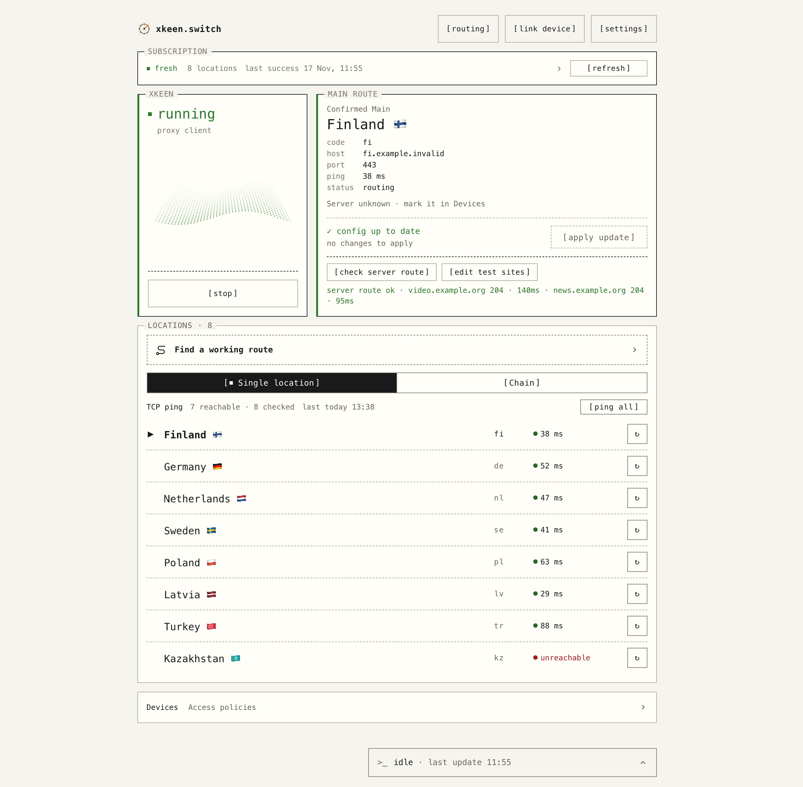
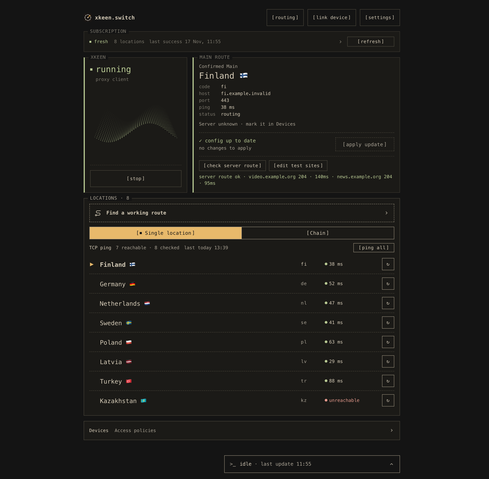
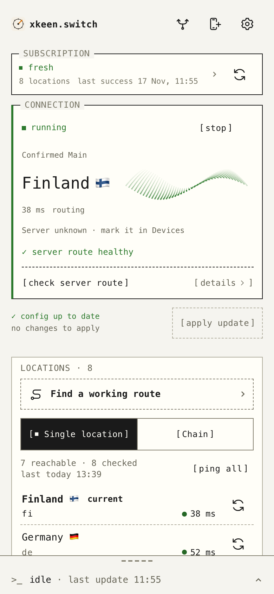
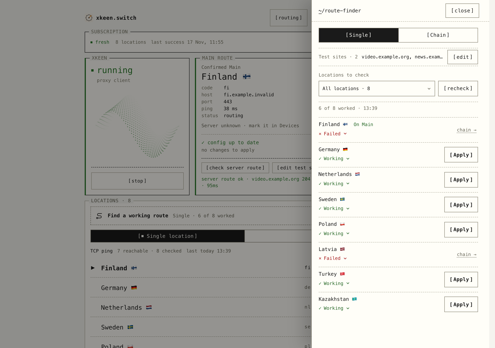
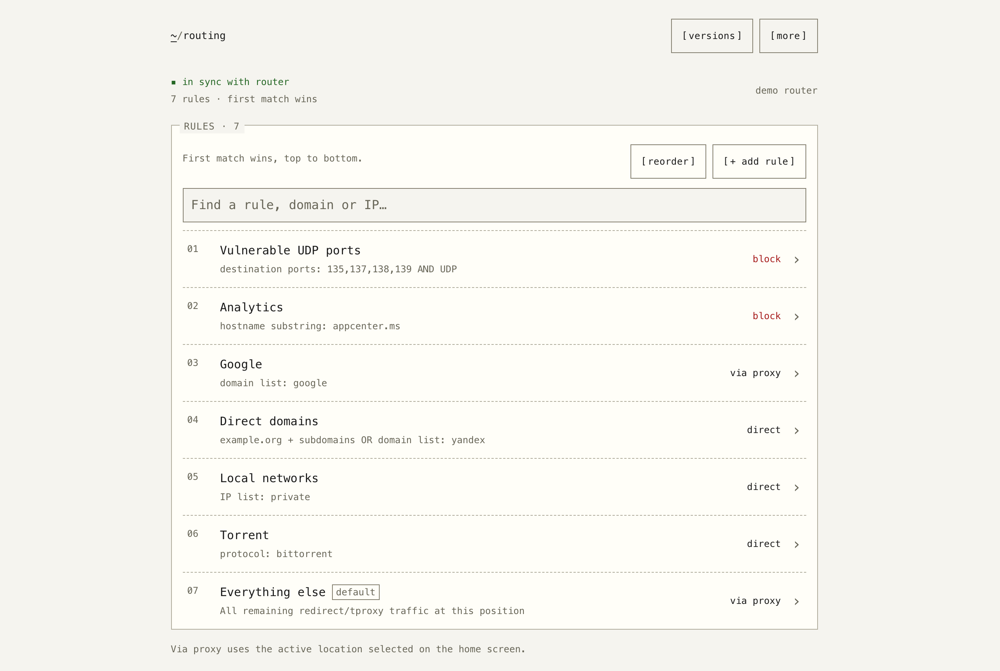
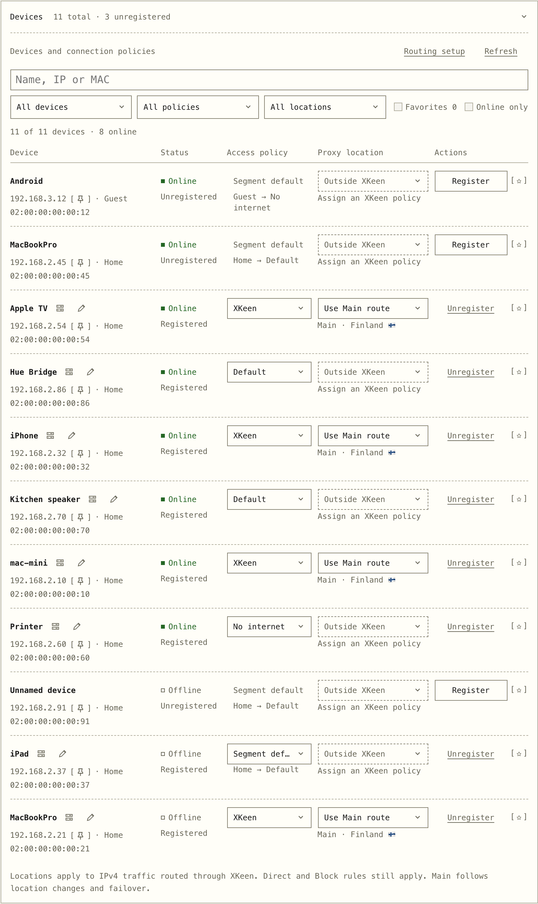
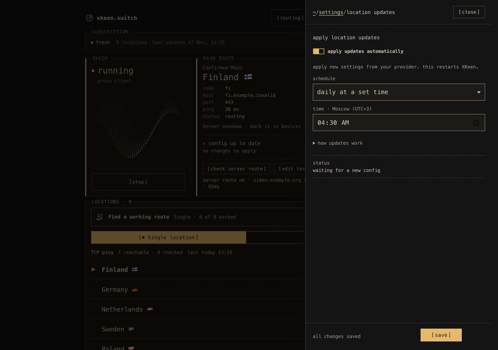

# xkeen-switcher

[Русский](README.md) · **English**

A web dashboard for Keenetic routers running [XKeen](https://github.com/jameszeroX/XKeen). Switch VPN locations (VLESS/Reality and other Xray protocols) with one tap from a phone or computer, with automatic failover, a routing rule editor, per-device locations, and XKeen/Xray updates with rollback.

[](https://github.com/astronautr/xkeen-switcher/actions/workflows/ci.yml)


[](LICENSE)



## Why

With XKeen alone, changing location means editing `04_outbounds.json` over SSH and running `xkeen -restart`. That is awkward from a phone, and a broken config leaves the whole network without a proxy.

xkeen-switcher runs as a small container on any always-on home machine (Mac mini, NAS, Linux server) and manages the router over SSH. Every change is validated with `xray run -test` and applied as a transaction on the router with automatic rollback. The server is **not in the traffic path**: if it goes down, the router keeps running the last applied location.

## Features

**Locations**
- Locations come from your provider's subscription: a base64 list of `vless://` links or a JSON array of Xray configs, including Shadowsocks. The subscription refreshes on a schedule and on demand.
- One-tap switching with visible progress: preparing, applying, confirmed, or rolled back. If you close the tab or SSH drops, the server finishes the operation anyway.
- **Chains:** route through two different nodes (home → entry → exit → internet).
- **TCP ping** for every location and a **route check** that sends real HTTPS requests to your test sites through the current route.
- **Find a working route** tests selected locations and chains with real HTTPS on the router and lets you apply any route that works.

**Reliability**
- **Failover:** when the current location fails, the server switches to the next backup from your priority list. It can return to the preferred location and stop XKeen when nothing works.
- **Deferred updates:** provider config changes (for example, rotated SNI) are applied on your schedule — daily at a set time or after an interval — not in the middle of the day.
- Router-side transactions: exact file snapshots, an independent watchdog, and recovery after reboot (`S04`/`S06` init scripts).

**Routing and devices**
- **Rule editor** for `05_routing.json`: domains, geosite/geoip, IP/CIDR, ports, protocols. Changes go to a draft first; before applying you see a diff and the Xray validation result. Version history and byte-exact restore of the original file are included.
- **Keenetic devices:** registration, access policies, IP reservation, Undo.
- **Per-device locations:** for example, the TV always exits in the Netherlands while everything else follows the main location.

**Maintenance and access**
- **XKeen and Xray updates** from the dashboard: now, on a schedule, or automatically. A rollback point is saved before installation; roll back from the dashboard or from an SSH menu on the router.
- Admin password sign-in, one-time six-digit pairing codes, and per-browser session revocation.
- **PWA:** add it to the iPhone Home Screen and it opens like an app.
- Light and dark themes, responsive layout.

## Screenshots

| Dark theme | Phone |
|---|---|
|  |  |

| Find a working route | Routing editor |
|---|---|
|  |  |

| Devices | Update settings |
|---|---|
|  |  |

## How it works

```
Browser / iPhone ──HTTP (LAN)──▶ xkeen-switcher (Docker on a home server)
                                      │
                                      ├─SSH──▶ Keenetic + Entware: XKeen, Xray, helper scripts
                                      └─RCI──▶ Keenetic: devices and policies (optional)
```

The service only writes configuration it owns: `04_outbounds.json`, `05_routing.json` (through the editor), and its own overlay for per-device locations. `03_inbounds.json` and other XKeen files are left alone.

## Requirements

**Router**
- Keenetic with Entware (OPKG).
- XKeen installed and working, with the standard paths `/opt/etc/xray/configs` and `/opt/etc/init.d/S05xkeen`.
- Proxy rules in `05_routing.json` use the outbound tag `vless-reality` (the XKeen default).
- Password SSH access to Entware. Keenetic's Dropbear usually rejects ed25519 keys, so password login is the supported path.

**Server** — any always-on machine on the same network:
- Docker with the Compose v2 plugin: Docker Engine on Linux, Colima or Docker Desktop on macOS.
- `git`, `python3`, `ssh-keyscan` and `sshpass` on the host.
- Tested on macOS (Apple Silicon) with Colima. The images are multi-arch, so Linux on amd64/arm64 works too.

## Installation

### 1. Prepare the server

**Linux (Debian/Ubuntu):**

```bash
# Docker Engine + Compose: https://docs.docker.com/engine/install/
sudo apt install git python3 openssh-client sshpass
```

**macOS:**

```bash
brew install git colima docker docker-compose
brew install hudochenkov/sshpass/sshpass
mkdir -p ~/.docker
echo '{"cliPluginsExtraDirs":["/opt/homebrew/lib/docker/cli-plugins"]}' > ~/.docker/config.json
```

To run a Mac as a server without logging in, run these from the project directory (after step 2):

```bash
./scripts/setup-mac-always-on.sh   # disables sleep, restarts after power loss
./scripts/setup-mac-colima.sh      # Colima as a LaunchDaemon that starts at boot
```

### 2. Get the code

```bash
git clone https://github.com/astronautr/xkeen-switcher.git ~/xkeen
cd ~/xkeen
```

### 3. Fill in `.env`

```bash
cp .env.example .env
chmod 600 .env
```

Set at least `ROUTER_HOST` and `SSH_PASSWORD`. Put the subscription URL in `SUB_URL` or enter it later in the UI. Other options are listed under [Configuration](#configuration).

### 4. Run the bootstrap

```bash
./scripts/bootstrap-server.sh
```

The script:
1. records the router's host key in `ssh/xk_known_hosts`;
2. installs the helper scripts on the router (`xk-apply`, `xk-routing`, `xk-update`, recovery init scripts) and, when missing, the Entware packages `python3` and `daemonize`. It does not restart XKeen or change rules;
3. builds and starts the container;
4. prints the dashboard address.

### 5. Open the dashboard

Open `http://<server-address>:8080/` and set the admin password on the **Create admin password** screen (12 characters or more). Then:

1. If the subscription isn't in `.env`, click the **Subscription** row and paste the URL.
2. Pick a location in **Locations** — it becomes the main one (Main).
3. Optionally: **settings → failover** for backup locations, **settings → test sites** for route-check sites.

## Usage

### Switching locations

- **Single location** sends all proxied traffic through one location. Click a location row to apply it.
- **Chain**: choose Entry and Exit, then **Apply chain**. Automatic failover is paused while a chain is active.
- **ping all** and the ↻ button on each row check TCP reachability of the servers. **check server route** sends HTTPS requests to your test sites through the current route.
- **Find a working route** checks selected locations (Single) or exits through selected entries (Chain) directly on the router. Click **Apply** on a Working row to use that route.

Switching uses the saved subscription and never waits for the provider. When the provider changes the active location's parameters, **apply update** appears on the dashboard. Apply it by hand or on a schedule (**settings → location updates**). The subscription is always re-downloaded right before applying.

### Failover

In **settings → failover**, enable **switch if the connection fails** and order your locations: the first is preferred, the rest are backups. The server regularly checks TCP reachability and the HTTPS route. After several consecutive failures it switches to the next working location. You can also turn on returning to the preferred location and stopping XKeen when nothing works.

### Routing editor

**routing** opens the rules from `05_routing.json` in priority order; the first match wins. Each rule sends traffic through the proxy (**via proxy**), directly (**direct**), or blocks it (**block**). The workflow:

1. Edit a rule and click **save to draft**. The draft lives on the server and survives reloads.
2. **review changes** shows a diff and runs `xray run -test` on the complete config set.
3. **apply and restart** writes the file and restarts XKeen. If XKeen fails to start, the helper restores the previous file.

The "Everything else" rule for remaining traffic can be edited and moved but not deleted. Comments and unknown fields are preserved. **versions** keeps snapshots, including the original file; restore and download are byte-exact.

### Devices

Set `KEENETIC_USER` and `KEENETIC_PASSWORD` (a Keenetic web-interface account) and restart the container. The **Devices** section on the dashboard lets you:
- register devices, rename them and change their access policy, with Undo;
- reserve an IPv4 address for a MAC in DHCP;
- give a device its own **Proxy location** instead of Main.

First, mark the Keenetic policies routed through XKeen in **Devices → Routing setup**. Details: [docs/devices.md](docs/devices.md), [docs/device-locations.md](docs/device-locations.md).

### XKeen and Xray updates

**settings → router updates** shows installed versions and GitHub releases. Update now, on a schedule, or automatically every day. The helper saves a rollback point on the router before installing. If the server is unavailable, roll back from the router itself: `ssh` into Entware and run `/opt/bin/xk-update-recovery`.

### Sign-in, devices and iPhone

- **link device** in the header issues a one-time code valid for 5 minutes. On the other device choose **Sign in with code**.
- **settings → access** lists signed-in browsers, revokes sessions and changes the password.
- **iPhone/iPad:** open `http://<server-address>:8080/` in Safari, sign in, then Share → **Add to Home Screen**. If Safari forces HTTPS, turn off **Settings → Apps → Safari → Advanced → Upgrade to HTTPS** (older iOS versions may name it differently).

Forgot the password? Run `./scripts/set-password.sh` on the server: it sets a new password and signs out every session. Details: [docs/auth.md](docs/auth.md).

## Updating the app

On the server:

```bash
cd ~/xkeen
git pull
./scripts/deploy-local.sh                        # rebuild and restart the container
./scripts/deploy-local.sh --with-routing-helper  # same, plus update router helper scripts
```

Update the helper when a release changes files under `router/`. The installer refuses to run while a router operation is unfinished.

Developing on another machine: `./scripts/deploy.sh <user@server>` syncs the code with rsync (excluding `.env`, `ssh/` and `data/`) and rebuilds the container. `XK_DEPLOY_DIR` sets the server directory relative to the home directory (default `xkeen`).

## Configuration

These options go in `.env`; everything else is configured in the UI.

| Variable | Default | Description |
|---|---|---|
| `ROUTER_HOST` | `192.168.1.1` | Router address. `mock` runs a demo without a router |
| `ROUTER_USER` | `root` | Entware SSH user |
| `ROUTER_PORT` | `22` | Entware SSH port |
| `SSH_PASSWORD` | — | SSH password. Required |
| `SUB_URL` | — | Subscription URL. Can be set in the UI |
| `KEENETIC_URL` | `http://<ROUTER_HOST>` | Keenetic web-interface origin for RCI, without a path |
| `KEENETIC_USER` / `KEENETIC_PASSWORD` | — | Web-interface account for Devices |
| `XK_DEVICE_POLICY_IDS` | policies named `XKeen` | Policies routed through XKeen: `policy:Policy0,policy:Policy2` or `default` |

Data lives in `./data` on the server: state, subscription cache, history, sessions and routing snapshots. Include this directory in your backups.

## Security

- The dashboard is meant for **your home network only** and uses plain HTTP. Do not expose port 8080 to the internet. For remote access, use a VPN into your home network (for example, WireGuard on Keenetic).
- The password is stored as a PBKDF2-SHA256 hash; sessions use HttpOnly cookies. Every mutating request requires JSON and an `X-XK-Request` header; foreign `Origin` requests are rejected.
- `.env` holds the router password: keep it at mode `600` and never commit it.

To report a vulnerability, see [SECURITY.md](SECURITY.md).

## Limitations

- Schedules (config updates, XKeen/Xray installs) use Moscow time (UTC+3).
- Hysteria2 nodes are listed, but the tested Xray versions have no Hysteria outbound: switching to one leaves the proxy down until you switch back.
- Tested on one home Keenetic with one provider. Reports from other models and providers are welcome.

## Troubleshooting

| Symptom | What to check |
|---|---|
| Dashboard doesn't open | `docker ps` on the server; `curl http://<server>:8080/api/health` → `{"ok": true}`. A Mac must not sleep (`pmset -g`) |
| XKeen `unknown` / SSH errors | `SSH_PASSWORD` and `ROUTER_PORT` in `.env`; `sshpass -e ssh -p <port> root@<router> 'echo ok'`; logs: `docker logs xk-switcher` |
| Location switched but traffic goes direct | The device must be in a Keenetic policy routed through XKeen, and `05_routing.json` must use the `vless-reality` tag |
| Operation "waiting for confirmation" | The server keeps checking on its own. Don't delete lock files on the router. Journal: `/opt/var/lib/xk-switcher/routing/operations/` |
| Locked out | Sign in with a code from another device or run `./scripts/set-password.sh` |

## Development

Demo mode without a router or subscription:

```bash
python3.12 -m venv .venv && .venv/bin/pip install -e '.[dev]'
npm --prefix frontend ci --ignore-scripts   # Node 24.18.0, see frontend/.node-version
./scripts/dev-native.sh                     # http://127.0.0.1:8766/
```

Tests:

```bash
.venv/bin/python -m pytest                  # backend, helper scripts, API
npm --prefix frontend run build && npm --prefix frontend test
```

The backend uses only the Python 3.12 standard library; the frontend uses React, TypeScript and Rspack. Architecture and conventions are described in [AGENTS.md](AGENTS.md), [frontend/README.md](frontend/README.md) and [docs/](docs/). How to contribute: [CONTRIBUTING.md](CONTRIBUTING.md).

## License

[MIT](LICENSE). Not affiliated with Keenetic, XKeen or Xray.
