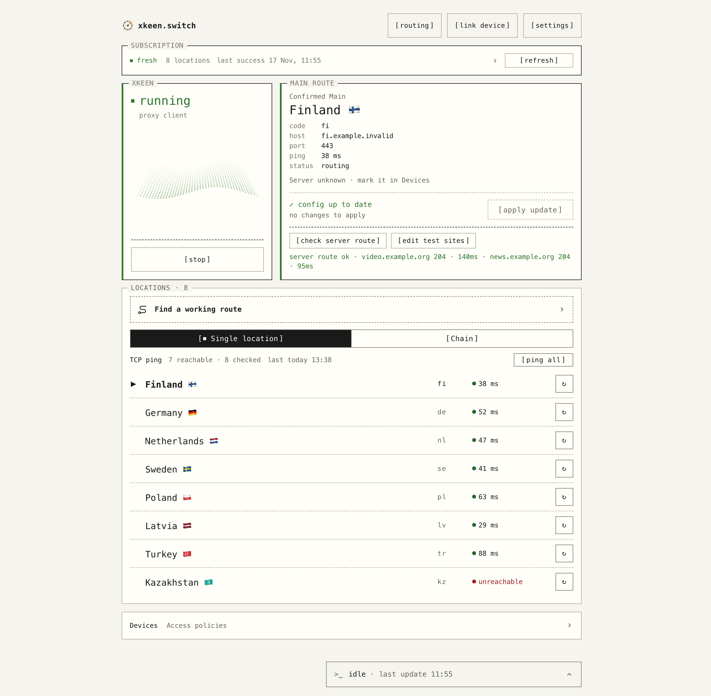
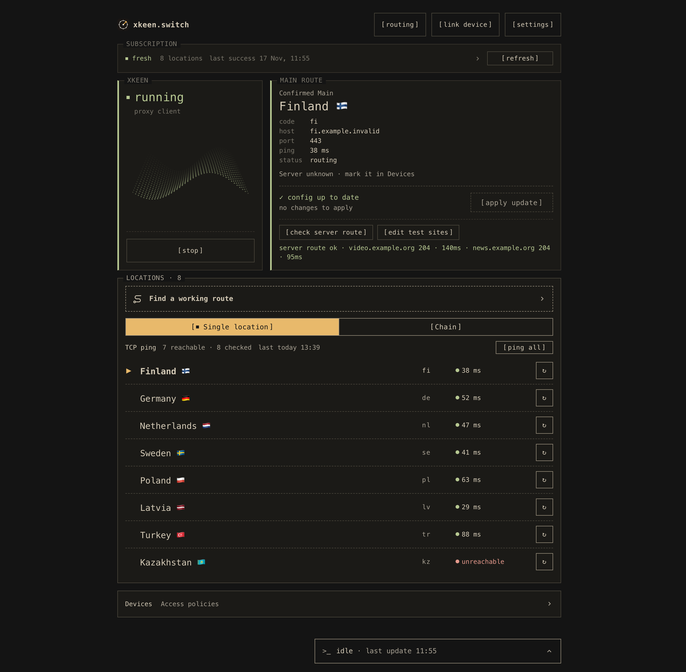
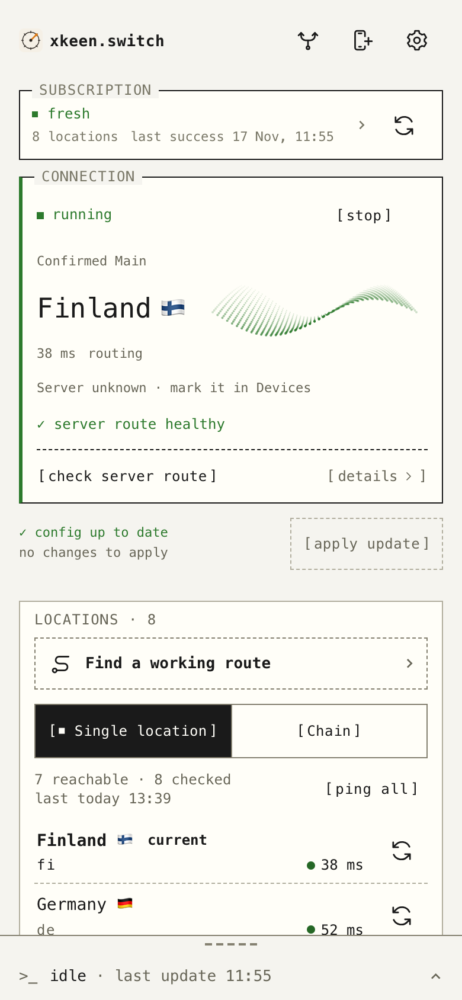
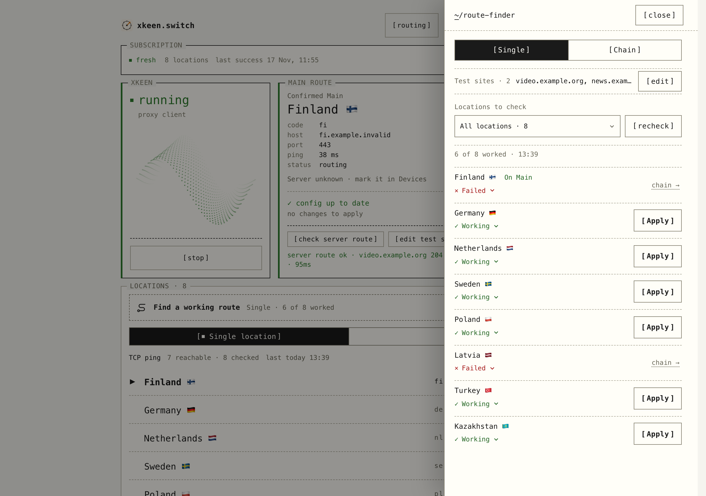
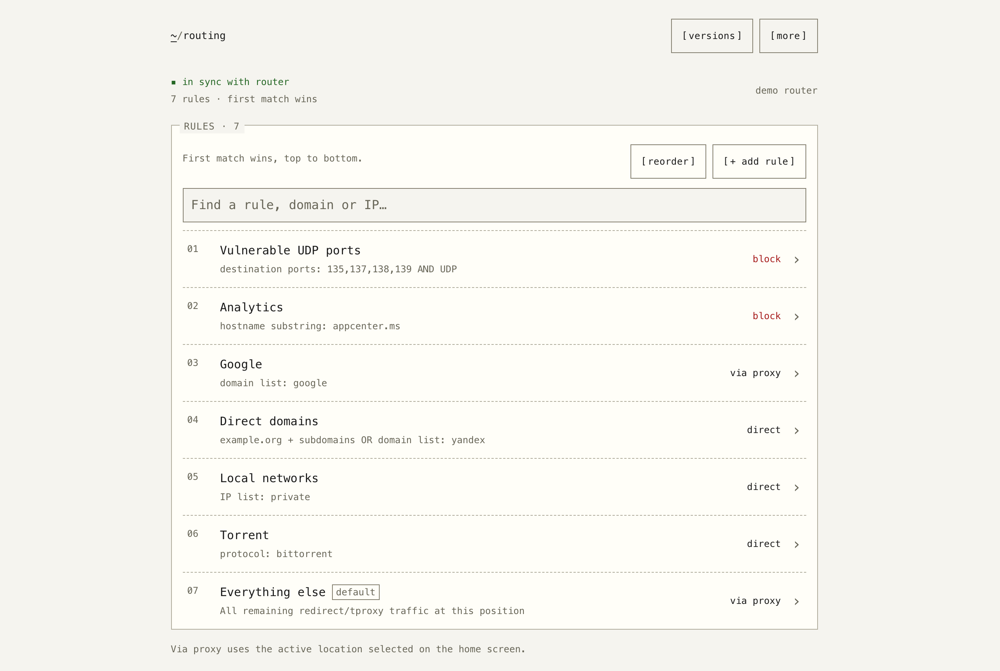
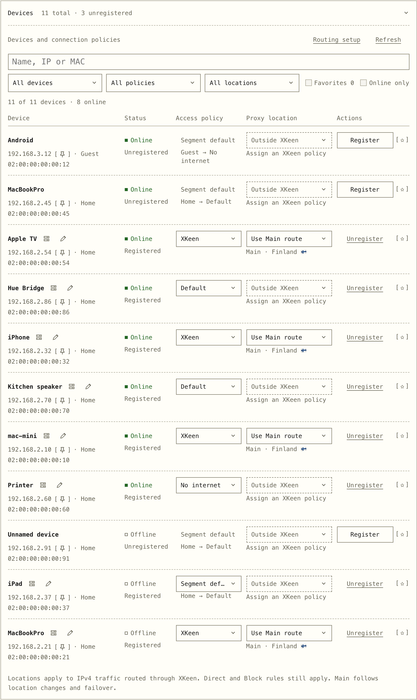
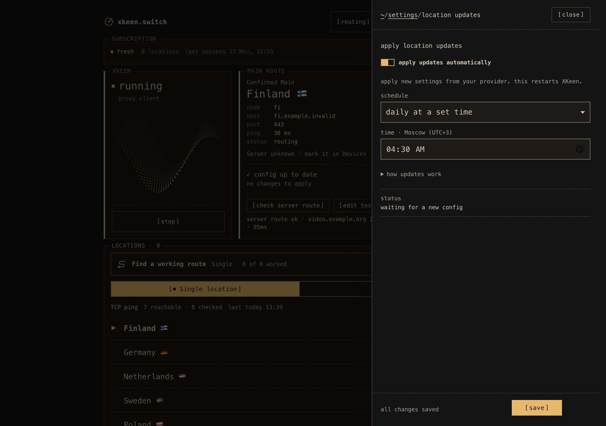

# xkeen-switcher

**Русский** · [English](README.en.md)

Веб-панель для роутера Keenetic с [XKeen](https://github.com/jameszeroX/XKeen): переключение VPN-локаций (VLESS/Reality и другие протоколы Xray) в один тап с телефона или компьютера, автоматический failover, редактор маршрутизации, локации для отдельных устройств и обновление XKeen/Xray с откатом.

[](https://github.com/astronautr/xkeen-switcher/actions/workflows/ci.yml)


[](LICENSE)



## Зачем

В XKeen локация меняется правкой `04_outbounds.json` по SSH и `xkeen -restart`. С телефона это неудобно, а ошибка в конфиге оставляет всю сеть без прокси.

xkeen-switcher работает как небольшой контейнер на любом домашнем компьютере (Mac mini, NAS, Linux-сервер) и управляет роутером по SSH. Каждое изменение проверяется `xray run -test` и применяется транзакцией на роутере с автоматическим откатом. Сервер **не находится на пути трафика**: если он выключен, роутер продолжает работать на последней применённой локации.

## Возможности

**Локации**
- Список локаций из подписки провайдера: base64-список `vless://` или JSON-массив конфигураций Xray, включая Shadowsocks. Подписка обновляется по расписанию и вручную.
- Переключение в один тап. Ход операции виден на экране: подготовка, применение, подтверждение или откат. Если закрыть вкладку или оборвать SSH, сервер всё равно доведёт операцию до конца.
- **Цепочки:** вход и выход через два разных узла (дом → вход → выход → интернет).
- **TCP ping** всех локаций и **проверка маршрута**: реальные HTTPS-запросы через текущий маршрут к вашим тестовым сайтам.
- **Find a working route:** проверяет на роутере выбранные локации и цепочки реальным HTTPS и даёт применить любую рабочую.

**Надёжность**
- **Failover:** при отказе текущей локации переключается на запасную из вашего списка в порядке приоритета. Умеет вернуться на предпочтительную и остановить XKeen, если не работает ни одна.
- **Отложенное применение обновлений:** изменения конфигурации у провайдера (например, ротация SNI) применяются по расписанию — ежедневно в заданное время или через интервал, — а не посреди рабочего дня.
- Транзакции на роутере: точные снимки файлов, независимый watchdog, восстановление после перезагрузки (`S04`/`S06` init-скрипты).

**Маршрутизация и устройства**
- **Редактор правил** `05_routing.json`: домены, geosite/geoip, IP/CIDR, порты, протоколы. Изменения сначала сохраняются в черновик, перед применением показываются diff и результат проверки Xray. Есть история версий и восстановление исходного файла байт в байт.
- **Устройства Keenetic:** регистрация, политики доступа, закрепление IP, Undo.
- **Локация для отдельного устройства:** например, телевизор всегда через Нидерланды, остальные устройства — через основную локацию.

**Обслуживание и доступ**
- **Обновления XKeen и Xray** с панели: сразу, по расписанию или автоматически. Перед установкой сохраняется точка возврата, откат — из панели или из SSH-меню на роутере.
- Вход по паролю администратора и по одноразовому шестизначному коду, отзыв сессий отдельных браузеров.
- **PWA:** добавьте на экран «Домой» iPhone, и панель откроется как приложение.
- Светлая и тёмная темы, адаптивный интерфейс.

## Скриншоты

| Тёмная тема | Телефон |
|---|---|
|  |  |

| Поиск рабочего маршрута | Редактор маршрутизации |
|---|---|
|  |  |

| Устройства | Настройки обновлений |
|---|---|
|  |  |

## Как это работает

```
Браузер / iPhone ──HTTP (LAN)──▶ xkeen-switcher (Docker на домашнем сервере)
                                      │
                                      ├─SSH──▶ Keenetic + Entware: XKeen, Xray, helper-скрипты
                                      └─RCI──▶ Keenetic: устройства и политики (опционально)
```

Сервис пишет только конфигурации, которыми владеет: `04_outbounds.json`, `05_routing.json` (через редактор) и собственный overlay для локаций устройств. `03_inbounds.json` и остальные файлы XKeen не трогаются.

## Требования

**Роутер**
- Keenetic с установленным Entware (OPKG).
- Установленный и рабочий XKeen со стандартными путями: `/opt/etc/xray/configs`, `/opt/etc/init.d/S05xkeen`.
- Правила проксирования в `05_routing.json` используют outbound с тегом `vless-reality`. Это значение XKeen по умолчанию.
- SSH-доступ к Entware по паролю. Dropbear на Keenetic обычно отвергает ключи ed25519, поэтому поддерживается вход по паролю.

**Сервер** — любой постоянно включённый компьютер в той же сети:
- Docker с плагином Compose v2. На Linux это Docker Engine, на macOS — Colima или Docker Desktop.
- `git`, `python3`, `ssh-keyscan` и `sshpass` на хосте.
- Проверено на macOS (Apple Silicon) с Colima. Образы мультиархитектурные, Linux на amd64/arm64 тоже подходит.

## Установка

### 1. Подготовить сервер

**Linux (Debian/Ubuntu):**

```bash
# Docker Engine + Compose: https://docs.docker.com/engine/install/
sudo apt install git python3 openssh-client sshpass
```

**macOS:**

```bash
brew install git colima docker docker-compose
brew install hudochenkov/sshpass/sshpass
mkdir -p ~/.docker
echo '{"cliPluginsExtraDirs":["/opt/homebrew/lib/docker/cli-plugins"]}' > ~/.docker/config.json
```

Чтобы Mac работал как сервер без входа в систему, запустите из каталога проекта (после шага 2):

```bash
./scripts/setup-mac-always-on.sh   # отключает сон, включает автозапуск после сбоя питания
./scripts/setup-mac-colima.sh      # Colima как LaunchDaemon: стартует при загрузке
```

### 2. Получить код

```bash
git clone https://github.com/astronautr/xkeen-switcher.git ~/xkeen
cd ~/xkeen
```

### 3. Заполнить `.env`

```bash
cp .env.example .env
chmod 600 .env
```

Укажите как минимум `ROUTER_HOST` и `SSH_PASSWORD`. URL подписки можно задать здесь (`SUB_URL`) или позже в интерфейсе. Остальные параметры описаны в разделе [Конфигурация](#конфигурация).

### 4. Запустить bootstrap

```bash
./scripts/bootstrap-server.sh
```

Скрипт:
1. записывает ключ хоста роутера в `ssh/xk_known_hosts`;
2. ставит на роутер helper-скрипты (`xk-apply`, `xk-routing`, `xk-update`, init-скрипты восстановления), а при необходимости — Entware-пакеты `python3` и `daemonize`. Сам XKeen при этом не перезапускается, правила не меняются;
3. собирает и запускает контейнер;
4. печатает адрес панели.

### 5. Открыть панель

Откройте `http://<адрес-сервера>:8080/` и задайте пароль администратора на экране **Create admin password** (от 12 символов). Затем:

1. Если подписка не задана в `.env`, нажмите строку **Subscription** и вставьте URL.
2. Выберите локацию в списке **Locations** — она станет основной (Main).
3. По желанию: **settings → failover** — запасные локации, **settings → test sites** — сайты для проверки маршрута.

## Использование

### Переключение локаций

- **Single location** — весь проксируемый трафик идёт через одну локацию. Нажмите на строку локации, чтобы применить её.
- **Chain** — выберите Entry и Exit и нажмите **Apply chain**. Пока активна цепочка, автоматический failover приостановлен.
- **ping all** и кнопка ↻ в строке проверяют TCP-доступность серверов. **check server route** отправляет HTTPS-запросы к тестовым сайтам через текущий маршрут.
- **Find a working route** проверяет выбранные локации (Single) или выходы через выбранные входы (Chain) прямо на роутере. **Apply** в строке со статусом Working применяет этот маршрут.

Переключение использует сохранённую копию подписки и не ждёт провайдера. Если провайдер изменил параметры активной локации, на главном экране появится **apply update**. Применить изменения можно вручную или по расписанию (**settings → location updates**). Перед применением подписка всегда скачивается заново.

### Failover

В **settings → failover** включите **switch if the connection fails** и расставьте локации по приоритету: первая — предпочтительная, остальные — запасные. Сервер регулярно проверяет TCP-доступность локаций и HTTPS-маршрут. После нескольких неудачных проверок подряд он переключается на следующую рабочую локацию. Дополнительно можно включить возврат на предпочтительную локацию и остановку XKeen, когда не работает ни одна.

### Редактор маршрутизации

Кнопка **routing** открывает правила `05_routing.json` в порядке приоритета: срабатывает первое подходящее. Каждое правило отправляет трафик через прокси (**via proxy**), напрямую (**direct**) или блокирует (**block**). Порядок работы:

1. Отредактируйте правило и нажмите **save to draft**. Черновик хранится на сервере и переживает перезагрузку страницы.
2. **review changes** покажет diff и выполнит `xray run -test` на полном наборе конфигов.
3. **apply and restart** запишет файл и перезапустит XKeen. Если XKeen не стартует, helper вернёт прежний файл.

Правило «Everything else» для остального трафика можно редактировать и перемещать, но нельзя удалить. Комментарии и неизвестные поля сохраняются. В **versions** лежат снимки, включая исходный файл. Восстановление и скачивание возвращают файл байт в байт.

### Устройства

Задайте `KEENETIC_USER` и `KEENETIC_PASSWORD` (учётная запись веб-интерфейса Keenetic) и перезапустите контейнер. Раздел **Devices** на главном экране позволяет:
- регистрировать устройства, переименовывать их и менять политику доступа, с возможностью Undo;
- закреплять IPv4 за MAC в DHCP;
- назначать устройству собственную локацию (**Proxy location**) вместо основной.

Сначала в **Devices → Routing setup** отметьте политики Keenetic, трафик которых идёт через XKeen. Подробнее: [docs/devices.md](docs/devices.md), [docs/device-locations.md](docs/device-locations.md).

### Обновления XKeen и Xray

**settings → router updates** показывает установленные версии и релизы с GitHub. Обновить можно сразу, по расписанию или автоматически каждый день. Перед установкой helper сохраняет точку возврата на роутере. Если сервер недоступен, откатиться можно прямо с роутера: `ssh` в Entware и `/opt/bin/xk-update-recovery`.

### Вход, устройства и iPhone

- **link device** в шапке выдаёт одноразовый код на 5 минут. На другом устройстве выберите **Sign in with code**.
- **settings → access** — список вошедших браузеров, отзыв сессий и смена пароля.
- **iPhone/iPad:** откройте `http://<адрес-сервера>:8080/` в Safari, войдите, затем Share → **Add to Home Screen**. Если Safari принудительно переходит на HTTPS, отключите **Settings → Apps → Safari → Advanced → Upgrade to HTTPS** (на старых iOS пункт может называться иначе).

Забыли пароль? Выполните на сервере `./scripts/set-password.sh`: команда задаст новый пароль и завершит все сессии. Подробности: [docs/auth.md](docs/auth.md).

## Обновление приложения

На сервере:

```bash
cd ~/xkeen
git pull
./scripts/deploy-local.sh                        # пересобрать и перезапустить контейнер
./scripts/deploy-local.sh --with-routing-helper  # то же + обновить helper-скрипты на роутере
```

Обновлять helper нужно, если в релизе изменились файлы `router/`. Установщик откажется работать, пока на роутере не завершена предыдущая операция.

Разработка на другой машине: `./scripts/deploy.sh <user@server>` синхронизирует код через rsync (без `.env`, `ssh/` и `data/`) и пересобирает контейнер. Каталог на сервере задаётся переменной `XK_DEPLOY_DIR` относительно домашнего каталога, по умолчанию `xkeen`.

## Конфигурация

Параметры задаются в `.env`, остальные настройки — в интерфейсе.

| Переменная | По умолчанию | Описание |
|---|---|---|
| `ROUTER_HOST` | `192.168.1.1` | Адрес роутера. Значение `mock` включает демо-режим без роутера |
| `ROUTER_USER` | `root` | Пользователь SSH Entware |
| `ROUTER_PORT` | `22` | Порт SSH Entware |
| `SSH_PASSWORD` | — | Пароль SSH. Обязателен |
| `SUB_URL` | — | URL подписки. Можно задать в интерфейсе |
| `KEENETIC_URL` | `http://<ROUTER_HOST>` | Адрес веб-интерфейса Keenetic для RCI, без пути |
| `KEENETIC_USER` / `KEENETIC_PASSWORD` | — | Учётная запись веб-интерфейса для раздела Devices |
| `XK_DEVICE_POLICY_IDS` | политики с именем `XKeen` | Политики, идущие через XKeen: `policy:Policy0,policy:Policy2` или `default` |

Данные хранятся в `./data` на сервере: состояние, кеш подписки, история, сессии, снимки маршрутизации. Включите этот каталог в резервное копирование.

## Безопасность

- Панель рассчитана **только на домашнюю сеть** и работает по HTTP. Не открывайте порт 8080 в интернет. Для удалённого доступа используйте VPN до дома (например, WireGuard на Keenetic).
- Пароль хранится как хеш PBKDF2-SHA256, сессии — в HttpOnly cookie. Все изменяющие запросы требуют JSON и заголовок `X-XK-Request`, запросы с чужим `Origin` отклоняются.
- `.env` содержит пароль роутера: держите его с правами `600` и не коммитьте.

Как сообщить об уязвимости: [SECURITY.md](SECURITY.md).

## Ограничения

- Расписания (обновления конфигурации, XKeen/Xray) задаются по московскому времени (UTC+3).
- Узлы Hysteria2 отображаются в списке, но протестированные версии Xray не поддерживают этот протокол: переключение на такой узел оставит прокси нерабочим до переключения обратно.
- Проверялось на одном домашнем Keenetic и с одним провайдером. Будем рады отчётам о других моделях и провайдерах.

## Решение проблем

| Симптом | Что проверить |
|---|---|
| Панель не открывается | `docker ps` на сервере, `curl http://<сервер>:8080/api/health` → `{"ok": true}`. Mac не должен засыпать (`pmset -g`) |
| XKeen `unknown` / ошибки SSH | `SSH_PASSWORD` и `ROUTER_PORT` в `.env`; `sshpass -e ssh -p <порт> root@<роутер> 'echo ok'`; логи: `docker logs xk-switcher` |
| Локация переключилась, а трафик идёт напрямую | Устройство должно быть в политике Keenetic, которая проходит через XKeen. В `05_routing.json` нужен тег `vless-reality` |
| Операция «ожидает подтверждения» | Сервер сам продолжит проверку. Не удаляйте lock-файлы на роутере. Журнал: `/opt/var/lib/xk-switcher/routing/operations/` |
| Нет доступа к панели | Войдите по коду с другого устройства или выполните `./scripts/set-password.sh` |

## Разработка

Демо-режим без роутера и подписки:

```bash
python3.12 -m venv .venv && .venv/bin/pip install -e '.[dev]'
npm --prefix frontend ci --ignore-scripts   # Node 24.18.0, см. frontend/.node-version
./scripts/dev-native.sh                     # http://127.0.0.1:8766/
```

Тесты:

```bash
.venv/bin/python -m pytest                  # backend, helper-скрипты, API
npm --prefix frontend run build && npm --prefix frontend test
```

Backend написан на стандартной библиотеке Python 3.12, фронтенд — на React, TypeScript и Rspack. Архитектура и соглашения описаны в [AGENTS.md](AGENTS.md), [frontend/README.md](frontend/README.md) и [docs/](docs/). Как предложить изменения: [CONTRIBUTING.md](CONTRIBUTING.md).

## Лицензия

[MIT](LICENSE). Проект не связан с Keenetic, XKeen или Xray.
